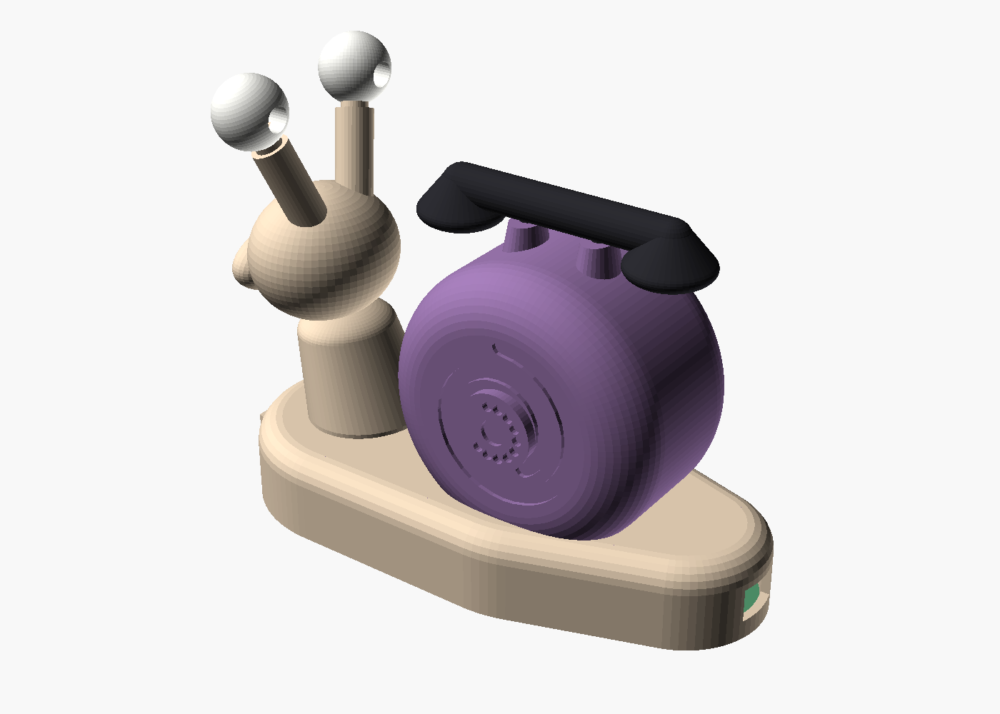
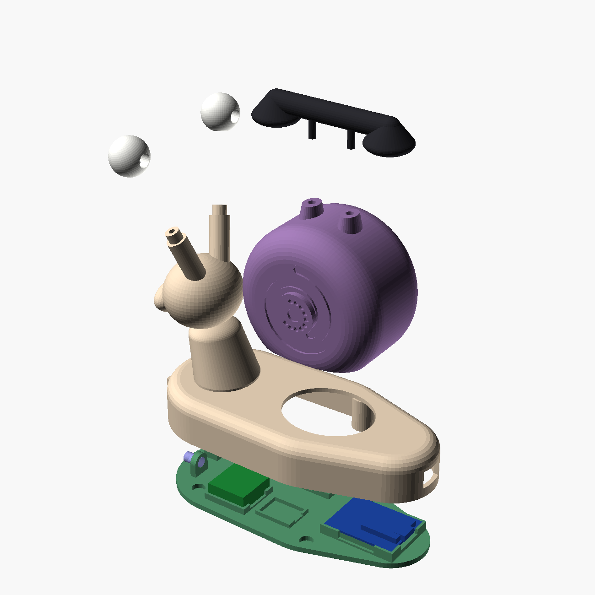
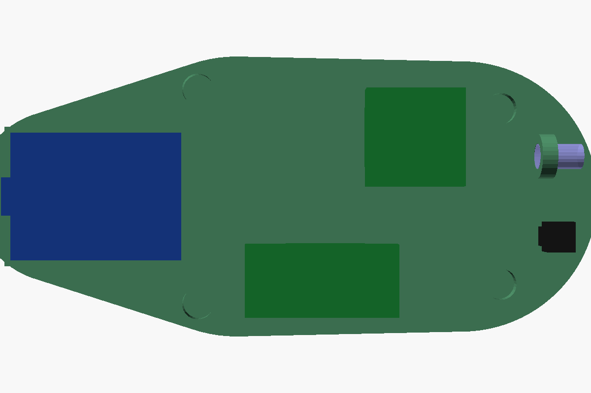

# Den Den Mushi enclosure

The RF bridge in a transponder snail from One Piece: a Wemos D1 mini, the
433 MHz transmitter and receiver, and room for an infrared emitter and receiver
to drive the LED strips. Printed in resin on the Anycubic Photon Mono M7
(plate 223 × 126 × 230 mm), like the mediaserver tower.

The eyes are IR LEDs: their domes are the pupils, so the snail looks at what it
drives. A third LED and the IR receiver look out of its chin, under the mouth.
The shell carries a spiral on each side, the rotary dial on the right one, and
the handset rests on a cradle on top.

## Parts

| Part | Size | Resin (no supports) | |
| :--- | :--- | :--- | :--- |
| `body` | 136 × 62 × 94 mm | 39 ml | foot, deck, neck, head, eye stalks; open underneath |
| `shell` | 66 × 49 × 62 mm | 33 ml | hollow, plugs into the deck opening and is glued there |
| `handset` | 72 × 20 × 17 mm | 6 ml | glued on the shell's two forks |
| `eye_right`, `eye_left` | 17 mm balls | 2 ml each | each takes a 5 mm IR LED from the back; they differ, the LED looks straight ahead whatever the stalk's lean |
| `cradle` | 127 × 57 mm, 2.5 mm plate | 17 ml | the floor: a pocket per component, 4 magnets hold it in the body |

About 100 ml in all, plus the supports. Overall about 136 × 62 × 110 mm.

## Files

- `denden.scad`: the parametric model. Pick a `part` at the top, or
  `openscad -D 'part="body"' -o stl/body.stl denden.scad` (add
  `--backend=Manifold`, it renders in seconds). `assembly`, `exploded`,
  `cradle_fit` and `section` are views.
- `stl/`: one STL per part from the current parameters.
- `renders/`: reference pictures.

## Before printing

The component sizes are nominal ones: measure yours and adjust the block at the
top of `denden.scad`, then re-export.

| Parameter | What to measure |
| :--- | :--- |
| `d1`, `d1_top`, `d1_bot` | D1 mini PCB L × W × thickness, the tallest part on top, the joints underneath |
| `usb`, `plug` | the micro-USB socket, and the overmould of the cable's plug (the tail tunnel lets it in to the board) |
| `tx`, `rx` | the 433 MHz transmitter (FS1000A, 19.5 × 19.5) and receiver (XY-MK-5V, 30.5 × 14.5) |
| `tsop`, `ir_led`, `ir_rim` | IR receiver body, IR LED diameter and flange |
| `magnet` | 6 × 2 mm discs, the tower's |

The body, the cradle and every component were checked against each other in
OpenSCAD: no part runs into another.

Print like the tower: ABS-like resin, Workshop's heavy supports. The body and
the shell print open side up (deck and shell top down), tilted 10 to 15° on two
axes; both are open underneath, so they drain on their own. The eyes print with
the LED bore horizontal, supported under the socket; the handset cups down.

## Wiring

Every part sits in its pocket on the cradle; the wires go from part to part,
soldered (no breadboard). The D1 mini keeps the pins of the NodeMCU:

| D1 mini | To |
| :--- | :--- |
| `D2` (GPIO4) | transmitter DATA |
| `D1` (GPIO5) | receiver DATA |
| `D5` (GPIO14) | IR driver: transistor base through 1 kΩ (later) |
| `D6` (GPIO12) | IR receiver OUT (later) |
| `5V` | transmitter VCC, receiver VCC, the IR LEDs' anode, IR receiver VCC (3.3 V for a VS1838B) |
| `G` | every ground, transistor emitter |

IR driver: the three IR LEDs in series (two eyes and the chin) with 10 Ω, from
5 V to the collector of a 2N2222, emitter to ground. About 80 mA through the
string, in short bursts: plenty for LED strip controllers across a room. The
firmware does not drive IR yet.

To flash a D1 mini: `make flash FQBN=esp8266:esp8266:d1_mini`.

## Assembly

1. Thread each eye's LED legs, with two thin wires soldered on, down its stalk
   and the neck into the foot; push the LED into the eye from the back and glue
   the eye on the stalk's peg.
2. Glue the shell into the deck opening and the handset on its forks.
3. On the cradle: D1 mini (USB to the tail), transmitter front left, receiver on
   the right, IR driver in the middle tray, IR receiver and third LED at the
   chin. Solder the wires, then the eye wires.
4. Antennas, about 17 cm each, kept straight-ish: the transmitter's curls up
   into the shell along its rim, the receiver's runs along the ledge inside the
   foot wall, under the deck.
5. Glue the 4 magnets in the body's bosses and 4 in the cradle, poles checked,
   and close it from underneath. Four 8 mm rubber feet in the dimples.

## Hardware

- Wemos D1 mini, FS1000A transmitter, XY-MK-5V receiver (the current ones)
- 3 × 5 mm IR LEDs, 940 nm (TSAL6200 or similar), a TSOP38238 or VS1838B
- 2N2222 (or any small NPN), 1 kΩ, 10 Ω
- 8 magnets 6 × 2 mm, 4 rubber feet 8 mm, thin wire
